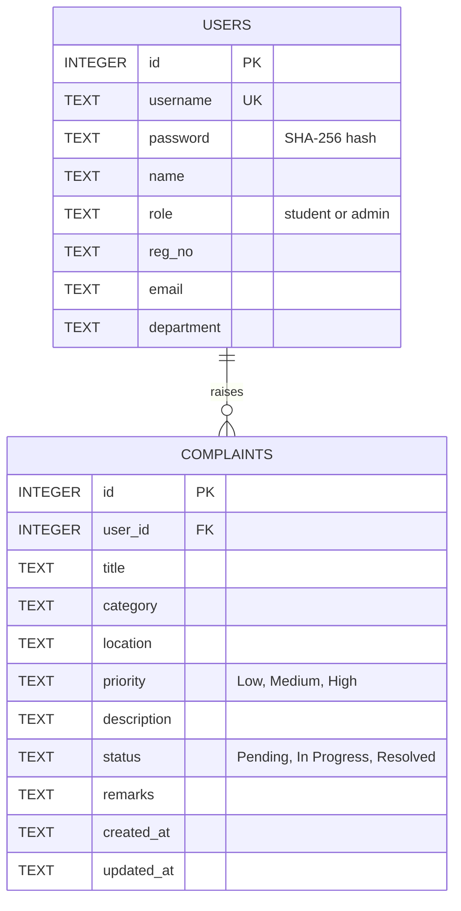
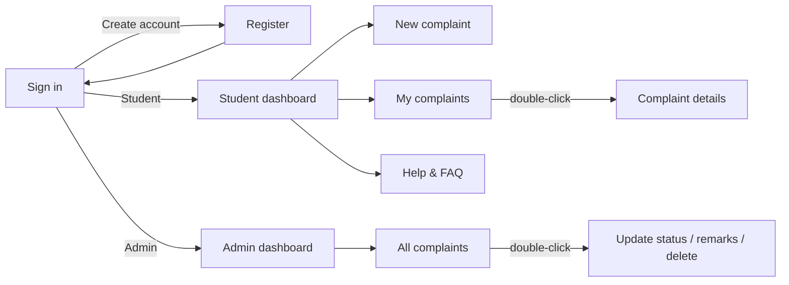
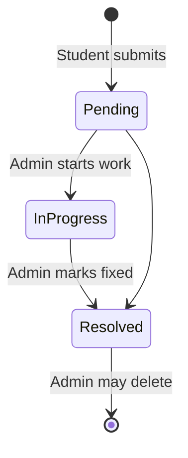

<p align="center">
  
</p>

<p align="center">
  <b>Your Campus. Your Voice. Our Resolution.</b><br>
  A campus helpdesk and complaint management system for SRMIST, built with Python, Tkinter and SQLite.
</p>

<p align="center">
  
  
  
  
</p>

---

## Table of contents

- [About the project](#about-the-project)
- [Features](#features)
- [Screenshots](#screenshots)
- [Tech stack](#tech-stack)
- [Getting started](#getting-started)
- [Demo accounts](#demo-accounts)
- [Project structure](#project-structure)
- [Database design](#database-design)
- [How it works](#how-it-works)
- [Design decisions](#design-decisions)
- [Demo walkthrough](#demo-walkthrough)
- [Future improvements](#future-improvements)

---

## About the project

On a large campus, problems like a broken projector, patchy Wi-Fi or a water leak are often reported by word of mouth and then forgotten. **UniResolve** gives students one place to report these problems and see what happens to them.

- **Students** raise a complaint, get a ticket number and follow its progress from *Pending* to *Resolved*.
- **Administrators** see every complaint on campus, update its status and leave remarks that the student can read.

All data is stored in a SQLite database, so complaints, accounts and updates are kept after the app is closed.

---

## Features

### Student portal
- **Register** with an official `@srmist.edu.in` email and an `RA...` registration number (both are validated).
- **Dashboard** with Total, Pending, In Progress and Resolved counts, plus recent complaints.
- **Raise a complaint** with a title, category, location, priority and description. Locations can be picked from the list or typed in.
- **Ticket numbers** such as `CMP009` are generated for every complaint.
- **My Complaints** with live search, a status filter and a details view that shows the admin's remarks.
- **Help & FAQ** with common questions and the helpdesk's contact details.

### Admin portal
- **Campus-wide dashboard** with status counts and a *complaints by category* chart.
- **All Complaints** from every student, with search and a status filter.
- **Update a complaint:** change its status (Pending → In Progress → Resolved) and add remarks.
- **Delete resolved complaints** after a confirmation. Open complaints cannot be deleted.

### General
- Passwords are stored as SHA-256 hashes, never as plain text.
- One-click demo logins on the sign-in screen.
- Colour-coded status dots: 🟠 Pending, 🔵 In Progress, 🟢 Resolved.
- Runs on Windows, macOS and Linux with no extra packages.

**Categories:** Infrastructure, Electrical, IT & Network, Cleanliness, Classroom & Lab
**Locations:** Tech Park 1, Tech Park 2, Java Canteen, University Building, TP Ganesan, Vendhar Square, Hostel (or any location typed in)

---

## Screenshots

| Sign in | Student dashboard |
|:---:|:---:|
|  |  |
| **Raise a complaint** | **Help & FAQ** |
|  |  |
| **Admin dashboard** | **All complaints (admin)** |
|  |  |

<p align="center">
  <br>
  <i>Admin view of a complaint: update the status, add remarks, or delete it once resolved</i>
</p>

---

## Tech stack

| Layer | Technology | Why |
|---|---|---|
| Language | Python 3.8+ | Simple, readable, widely taught |
| Front end | Tkinter + `ttk` | Built into Python, nothing to install |
| Database | SQLite (`sqlite3` module) | Real SQL database stored in a single file, no server needed |
| Security | `hashlib` (SHA-256) | Passwords are never stored in plain text |

Everything above is part of Python's standard library, so there is no `requirements.txt`.

---

## Getting started

### 1. Check Python

```bash
python --version      # Windows
python3 --version     # macOS / Linux
```

Python 3.8 or newer is needed. Tkinter comes with Python on Windows and macOS. On Ubuntu/Debian, install it with:

```bash
sudo apt install python3-tk
```

### 2. Clone the repository

```bash
git clone https://github.com/krish3527/Smart-Campus-Helpdesk-Complaint-Management-System.git
cd Smart-Campus-Helpdesk-Complaint-Management-System
```

### 3. Run the app

```bash
python app.py         # Windows
python3 app.py        # macOS / Linux
```

On the first run the app creates `uniresolve.db` and fills it with sample data.

> **To reset all data**, close the app, delete `uniresolve.db`, and run it again.

---

## Demo accounts

| Role | Username | Password | Name |
|---|---|---|---|
| Admin | `admin` | `admin123` | Admin |
| Student | `student1` | `student123` | Rahul Sharma (RA2511003010001) |
| Student | `student2` | `student123` | Priya Patel (RA2511003010045) |

The **Student** and **Admin** buttons under *Quick Demo* on the sign-in screen fill these in for you.

---

## Project structure

```
├── app.py                  # User interface: every screen of the app
├── database.py             # Data layer: every SQL query lives here
├── schema.sql              # CREATE TABLE statements
├── assets/
│   ├── uniresolve-logo.svg       # Logo for light backgrounds
│   ├── uniresolve-logo-dark.svg  # Logo for the green sidebar
│   ├── logo_login.png            # PNG versions loaded by Tkinter
│   ├── logo_sidebar.png
│   └── logo_crest.png            # Window icon
├── screenshots/            # Images used in this README
└── uniresolve.db           # Created automatically (not committed)
```

The interface (`app.py`) never writes SQL. It only calls functions in `database.py`. This **separation of concerns** keeps each file focused on one job.

---

## Database design

### Entity-relationship diagram



- **One-to-many:** one student can raise many complaints, and each complaint belongs to one student.
- **Constraints:** `UNIQUE` on usernames, `CHECK` on role, priority and status, and a `FOREIGN KEY` from complaints to users.
- **Defaults:** new complaints start as `Pending`, with the timestamps filled in by SQLite.

The full schema is in [`schema.sql`](schema.sql).

### SQL used for each feature

| Feature | SQL | Function in `database.py` |
|---|---|---|
| Sign in | `SELECT ... WHERE username = ? AND password = ?` | `login()` |
| Register | `INSERT` (with a `UNIQUE` username) | `register_student()` |
| Raise a complaint | `INSERT` | `add_complaint()` |
| List complaints with the student's name | `JOIN` | `get_complaints()` |
| Search | `LIKE '%text%'` | `get_complaints()` |
| Filter by status | `WHERE status = ?` | `get_complaints()` |
| Update status and remarks | `UPDATE ... SET ... WHERE id = ?` | `update_status()` |
| Delete a resolved complaint | `DELETE ... WHERE id = ? AND status = 'Resolved'` | `delete_complaint()` |
| Dashboard counts | `COUNT(*) ... GROUP BY status` | `get_stats()` |
| Category chart | `GROUP BY category ORDER BY COUNT(*)` | `get_category_counts()` |

---

## How it works

### Screen flow



### Life of a complaint



### Code overview

| Part | Where | What it does |
|---|---|---|
| `UniResolveApp` | `app.py` | The main window. It inherits from `tk.Tk` and keeps track of the logged-in user. |
| `show_login()`, `show_register()` | `app.py` | The sign-in and registration screens |
| `show_main()`, `go()` | `app.py` | Builds the sidebar and switches between pages |
| `page_dashboard()`, `page_new_complaint()`, `page_complaints()`, `page_help()` | `app.py` | One method per page |
| `complaints_table()`, `show_details()` | `app.py` | The complaints table and the details popup |
| `init_db()` | `database.py` | Creates the tables and adds sample data on the first run |

---

## Design decisions

**Why SQLite instead of MySQL?**
SQLite is built into Python and needs no database server, so the project runs anywhere with one command. It uses standard SQL, so moving to MySQL later would only mean changing the connection code in `database.py`.

**How is SQL injection prevented?**
Every query uses **parameterised placeholders** (`?`). User input is passed separately from the SQL text and is never joined into the query string.

**How are passwords protected?**
Passwords are hashed with SHA-256 before they are saved. At sign-in, the typed password is hashed and compared with the stored hash.

**Why can only resolved complaints be deleted?**
So an open problem can't be removed by mistake before it is fixed. The rule is enforced in the SQL itself (`AND status = 'Resolved'`), not just by hiding the button.

**How do students see the admin's updates?**
Both portals read from the same `complaints` table. When the admin saves, an `UPDATE` changes the row, and the student's next view runs a fresh `SELECT`.

**Why are the buttons Labels instead of `tk.Button`?**
macOS ignores custom colours on `tk.Button`, so styled buttons would show up grey. Clickable Labels look the same on every operating system.

---

## Demo walkthrough

1. Run `python app.py`, click **Student** under *Quick Demo*, then **Sign In**.
2. Look at the dashboard counts and recent complaints.
3. Open **New Complaint** and enter, for example: *AC leaking in Lab 1105*, Electrical, Tech Park 1, High. Submit it and note the ticket number.
4. The complaint appears in **My Complaints** with an orange *Pending* dot.
5. Open **Help & FAQ** to see the student help page.
6. Sign out, click **Admin**, then **Sign In**. Look at the category chart.
7. Open **All Complaints**, double-click the new ticket, set it to **Resolved**, add a remark and save.
8. Sign back in as the student. The status and the remark have been updated.
9. As admin, open the resolved complaint again. Its **Delete** button is now available.

---

## Future improvements

- Route complaints to department staff accounts (Electrical, IT, Housekeeping) based on category
- Email notifications when a complaint's status changes
- Photo attachments for complaints
- Password reset by email
- A web version using Flask or Django

---

<p align="center">Developed for SRMIST · Campus Helpdesk</p>
